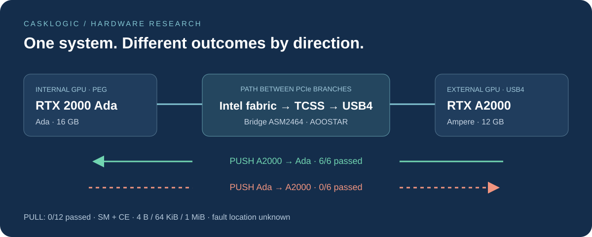

<p align="center"></p>
<h1 align="center">CaskLogic PCIe P2P Lab</h1>
<p align="center"><strong>Two GPUs. Two PCIe branches. Successful writes in only one direction.</strong><br>An open investigation into the Minisforum MS-01, RTX 2000 Ada and RTX A2000 over USB4.</p>
<p align="center">


</p>
<p align="center"><a href="docs/technical-summary.en.md">Technical summary</a> · <a href="#key-results">Results</a> · <a href="firmware/README.md">Experimental BIOS</a> · <a href="docs/indice.md">Archive index</a></p>



## Why this repository exists

This repository collects **Piero Borgatta / CaskLogic's** investigation of 20–21 October 2026: CUDA tests, experimental NVIDIA RM/UVM modifications, BIOS/FSP analysis, measurements and negative results. It gives researchers familiar with PCIe, Intel TCSS, USB4 or NVIDIA drivers concrete evidence to review and a basis for proposing the next useful diagnostic step.

**There is no verified fix for bidirectional P2P.** A reported capability, a changed register or a completed DMA command does not prove correct payload delivery. Successful comparisons in one direction do not qualify the experimental implementation for production, atomics, NCCL or training.

## Hardware and environment

| Component | Observed configuration |
|---|---|
| Computer | Minisforum MS-01, Intel Core i9-12900H, CPUID `906A3` |
| BIOS | AHWSA 1.26; static comparison with 1.27 |
| Internal GPU | NVIDIA RTX 2000 Ada Generation, 16 GB, Ada, compute capability 8.9 |
| External GPU | NVIDIA RTX A2000, 12 GB, Ampere, compute capability 8.6 |
| Dock | AOOSTAR, 800 W power supply; AG02 is plausible, but the model label and PCB revision are unconfirmed |
| Bridge | ASM2464 family, PCI bridges `1b21:2461` |
| Route | Internal PEG ↔ Intel fabric ↔ TCSS/USB4 root ↔ bridge ↔ external GPU |
| Test driver | NVIDIA 595.99.02, with separately documented experimental variants |
| Environments | Passthrough VM on XCP-ng and temporary native Linux in RAM, without Xen |

The external connection uses **PCIe tunneling over USB4**, rather than ordinary USB transfers. In the native tests, Ada is at `01:00.0` and A2000 at `06:00.0`; CUDA indices must not be assumed to match on other machines.

## Key results

The native PUSH/PULL experiment with validated initialization and synchronization checks compares **every word** of **4 B, 64 KiB and 1 MiB** payloads.

| Payload direction and operation | Executing GPU | SM passes | CE passes |
|---|---|---:|---:|
| PUSH Ada → A2000 | Ada | 0/3 | 0/3 |
| PUSH A2000 → Ada | A2000 | **3/3** | **3/3** |
| PULL Ada → A2000 | A2000 | 0/3 | 0/3 |
| PULL A2000 → Ada | Ada | 0/3 | 0/3 |

**18 failures in 24 comparisons.** CUPTI observes 12 copy-engine (CE) operations and 12 streaming-multiprocessor (SM) operations, with no dropped records. The first PULL uses a CE and precedes every peer-read SM operation. CUPTI is not a TLP capture and cannot alone rule out unexposed internal staging.

[Full PUSH/PULL analysis — Italian](archive/p2p-next-investigation-20261021/native-pushpull-results/ANALISI.md) · [Sanitized public log](archive/p2p-next-investigation-20261021/native-pushpull-results/result.log)

### What has been tested

| Experiment family | Outcome and limitation |
|---|---|
| Stock driver | CUDA peer access unavailable in both directions; some `nvidia-smi` reports show OK without demonstrating working transfers |
| libcuda patch and dynamic BAR1 path | Enable experiments; do not eliminate corruption or missing payload delivery |
| ACS, coherency, NoSnoop, Relaxed Ordering, MPS, GPA/HPA | No fully passing matrix; incomplete attempts are explicitly identified |
| Native Linux without Xen | Asymmetry persists; Xen is not a necessary condition |
| Corrected synchronization | Addresses a limitation in early tests; asymmetry remains after correction |
| BAR below 4 GiB, PTE/alignment, UVM 4 KiB, SYS_COH | No resolution in the documented variants |
| `SaSetup[0x3E3]`, FSP and PEG/TCSS CCFG | Bits actually changed and read back; Ada→A2000 still fails; the FSP span was subsequently restored |
| Physical CE, destination NONCOHERENT=2 / COHERENT=1 | Both complete the command but retain the same Ada→A2000 payload failure |
| NVML TX/RX with positive host↔GPU controls | Consistent with failed delivery along the path; aggregate counters cannot locate individual TLPs |
| AOOSTAR firmware and GPU architectures | No applicable official update identified; no established universal older→newer-only rule |

The [complete experiment history — Italian](archive/p2p-tcss-bit-tests-20261021/STORICO-PROVE.md) distinguishes completed executions, timeouts, attempts without data comparisons and preparation only. The [final transfer report](archive/p2p-next-investigation-20261021/ESITO.md) and [AOOSTAR/architecture review](archive/p2p-aoostar-architecture-20261021/ESITO.md) take precedence over hypotheses in older documents. An [English technical summary](docs/technical-summary.en.md) covers the main findings and limitations.

## Included BIOS and driver artifacts

The repository includes **two experimental full BIOS images** and **two candidate FSP regions**, with hashes, provenance and test status. The menu-modified BIOS was never flashed. The full PEG/TCSS image was reconstructed offline from the OEM BIOS; its FSP region was tested on the original machine, but the complete distributed image was not flashed.

**None of these BIOS variants fixes the problem.** These are not universal images: an incompatible flash can prevent booting. Hardware use requires exact board identification, your own backup and an available hardware recovery method. The repository does not automatically flash firmware or modify a server.

- [BIOS contents, limitations and reconstruction — Italian](firmware/README.md)
- [Download experimental firmware release — English notes](https://github.com/PieroBorgatta/CaskLogic-PCIe-P2P-Lab/releases/tag/research-2026-10-21)
- [Instrumented RM/BAR1 driver](archive/p2p-tcss-bit-tests-20261021/driver-instrumented/)
- [Physical CE UVM driver and contract — Italian](archive/p2p-next-investigation-20261021/driver-physical-ce/README.md)
- [CUDA reproducers, analyzers and offline checks — Italian](docs/riproducibilita.md)

The historical sources form a **research archive**, not a portable installer. Machine identifiers have been consistently replaced with fictional values; identity checks remain in place. Building for another system requires explicit review of those checks and dependencies, rather than indiscriminately removing them.

## Help we are looking for

1. Intel/OEM documentation on **PEG↔TCSS** peer Memory Write and Memory Read forwarding on Alder Lake-H, including relevant controls and initialization stages.
2. NVIDIA confirmation of support for the Ampere A2000 / RTX 2000 Ada pair, and review of the methods actually submitted.
3. AOOSTAR/ASMedia information about hardware revisions, firmware and acceptance of peer traffic originating from another PCIe branch.
4. A trace or targeted experiment that distinguishes **GPU requester behavior, Intel fabric routing and USB4 bridge acceptance**.

Swapping the cards or placing them behind the same PCIe switch is not possible in this setup. Relaying payloads through host RAM does not meet the objective. These constraints also limit the conclusions: GPU architecture and position in the topology remain correlated.

[Open a technical issue](https://github.com/PieroBorgatta/CaskLogic-PCIe-P2P-Lab/issues/new) with hardware details, topology, versions and payload comparison results. Please distinguish hypotheses from observed results.

## Repository layout and integrity

| Path | Contents |
|---|---|
| `archive/` | Sanitized historical reports, sources, patches, results and checks |
| `firmware/` | Modified OEM images, FSP regions and variant manifest |
| `docs/` | Technical summaries, archive index and reproducibility notes |
| `provenance/` | Original and published file hashes, exclusions and validation records |
| `tools/` | Local integrity checks and offline BIOS reconstruction |

```bash
python3 tools/verify_publication.py
python3 tools/replay_evidence.py
```

These commands read local files: they do not run GPU workloads, connect through SSH or write firmware. Confirming that an analyzer reconstructs 18 failures **does not** mean P2P works.

Personal SPI/NVRAM dumps, keys, credentials, VM disks, training corpora and checkpoints are excluded. Sanitized logs have different hashes from their originals; the manifest distinguishes both. Old internal manifests remain historical records, not checksums for the sanitized copies.

Most historical reports remain in their original Italian. Start with the [English technical summary](docs/technical-summary.en.md) for an overview.

## Sources and attribution

- [Linux PCI P2PDMA](https://www.kernel.org/doc/html/latest/driver-api/pci/p2pdma.html)
- [Linux Thunderbolt/USB4](https://www.kernel.org/doc/html/latest/admin-guide/thunderbolt.html)
- [NVIDIA open GPU kernel modules 595.99.02](https://github.com/NVIDIA/open-gpu-kernel-modules/tree/595.99.02)
- [CUDA Peer Device Memory Access](https://docs.nvidia.com/cuda/cuda-runtime-api/cuda_runtime_api/group__CUDART__PEER.html)
- [Intel datasheet 710723-003](https://cdrdv2-public.intel.com/710723/710723-003.pdf)

This project is not affiliated with or endorsed by NVIDIA, Intel, Minisforum or AOOSTAR. The CaskLogic name and original logo belong to the author's project. See [LICENSE.md](LICENSE.md) for the distinction between original contributions and third-party components.
